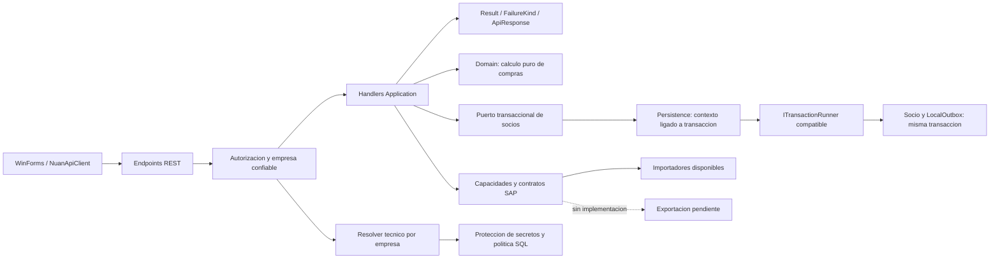

# Backend SOLID: estado consolidado

Fecha: 2026-10-24. Esta entrega registra codigo y verificacion local, no una liberacion de produccion.

## Catalogo de cambios y consumidores

| Area | Implementado y consumidores | Limite vigente |
|---|---|---|
| Arquitectura | Guardas de referencias/constructores y composicion real sin iniciar Host productivo. | No demuestran aislamiento de filas o rendimiento. |
| Errores SAP | Proveedores propagan cancelacion y resultados fallidos seguros/correlacionados. | No hay llamada SAP real. |
| Result/HTTP | FailureKind opcional; legacy/Validation400, NotFound404, Conflict409, Forbidden403, Unavailable503, Unexpected/unknown500 saneado; ApiResponse compatible. | Migracion inicial de consumidores; no todos los modulos tienen categorias nuevas. |
| Capacidades SAP | ISapSyncImporter/Exporter + ISapSyncProcessorRegistry; perfiles y scheduler intersectan configuracion e implementacion. | Siete importadores, cero exportadores; cuatro procesadores programados Full (Warehouses/Countries/Provinces/Cities). Both rechazado. |
| Socios/SAP | ISapSupplierImportRepository, misma implementacion scoped que IBusinessPartnerRepository. | DTO de importacion y metodos ADO internos siguen por compatibilidad. |
| Compras | PurchaseOrderAmountCalculator en Domain; adaptador Application; SapPurchaseOrderMapping para 22. | No cambian reglas monetarias, conversiones ni truncamientos. Falta de numeracion se rechaza. |
| Transacciones | Piloto BusinessPartnerUnitOfWork/Transaction; misma pareja ADO para socio y Outbox, guardas de empresa/lifetime/cancelacion; rollback preserva error original. | SQL aislado pendiente; callbacks secuenciales; contrato legacy y otras verticales se conservan. Sin deduplicacion durable nueva. |
| Empresa | Company sin campos fisicos/credenciales; CompanyConnectionInfo redaccion; builder tecnico interno. | Enums legacy conservados; MySQL no implementado. Admin DTO mantiene metadata autorizada y nunca passwords. |
| Validacion integrada | Endpoints y cliente HTTP reales con servidor en memoria, filtros de autorizacion/MediatR/handlers/serializacion. | Identidad controlada; no JWT firmado, sockets, TLS, SQL, SAP, SRI o workers operativos. |

## Grafo efectivo

Company empresarial no participa en descifrado o construccion de conexiones. Ni Domain ni WinForms llaman adaptadores SAP/SQL/HTTP directamente. Los selectores tecnicos legacy no constituyen soporte de proveedor ni de entrega bidireccional.

## Evidencia y compatibilidad

Los ADR y registros por fase se conservan en docs/architecture/BACKEND-SOLID-* y docs/operations/BACKEND-SOLID-PHASE-*-VALIDATION.md. El registro actual de comandos, resultados, manifiestos y gates es [BACKEND-SOLID-VALIDATION](../operations/BACKEND-SOLID-VALIDATION.md).

Los catalogos .codex/FRAMEWORK-CATALOG.md y .codex/KNOWLEDGE-GRAPH.md se reconcilian con estos contratos. Sus pruebas SQL historicas de otros incrementos no acreditan el nuevo piloto transaccional. El plan de endurecimiento SAP sigue separado; no se implementa aqui el dispatcher durable ni la exportacion pendiente.

## Estado de cierre

Validacion local completada con los limites documentados. Los tres fallos visuales se corrigieron el 2026-10-24: suite local 1263/1263, sin fallos, con evidencia en docs/operations/BACKEND-SOLID-WINFORMS-VALIDATION.md. La liberacion sigue pendiente de cumplir los gates SQL/seguridad/transporte propios del incremento a publicar. La fase 7 no se presenta como migracion global terminada. No se retiro el contrato legacy aun requerido ni se inicio despliegue, migracion, worker o conexion externa.
